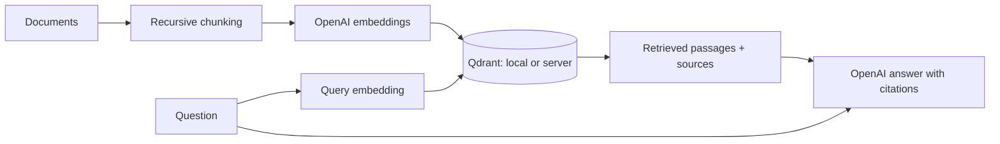

# RAG demo

An inspectable RAG pipeline over *Alice in Wonderland* or your own Markdown/text files.
**LangChain** splits documents, **OpenAI** embeds passages and generates answers, and
**Qdrant** stores and searches vectors in embedded local mode or on a server with HNSW support.



## Setup

Use Python 3.10+; Python 3.12 is recommended. From the repository root:

```bash
source .venv/bin/activate
python -m pip install --only-binary=:all: -r requirements.txt
python -m pip check
```

For a fresh checkout, create `.venv` first with `python3 -m venv .venv`.
Keep your API key in `.env`; `.env.example` lists the available settings.
`requirements.txt` contains all dependencies for the CLI, Streamlit UI, and tests.
The default embedded mode runs without a database server or Docker. Optional server
mode uses Docker or an existing Qdrant endpoint.

## Run the demo

### Streamlit application

From the repository root, install the dependencies and start the app:

```bash
source .venv/bin/activate
python -m pip install --only-binary=:all: -r requirements.txt
python -m streamlit run app.py --server.address 127.0.0.1
```

Open **http://localhost:8501** and keep the terminal running. Stop with **Ctrl+C**.
The chat input is pinned to the bottom of the page; questions and answers appear in
**Ask documents**. The input remains available while viewing **Documents & index**.
The app loads the existing `.env` and reuses the same pipeline and index as the CLI;
local mode needs no Docker. In server mode, start Qdrant first with `docker compose up -d`.

1. Open **Documents & index**, then **Preview chunks (free)** to inspect splitting.
2. Click **Inspect index (free)** to use an existing index, or **Build / rebuild index**
   to embed the configured document folder. Every rebuild incurs embedding charges.
3. Open **Ask documents** and ask a question. Expand sources to inspect passage text,
   cosine scores, character offsets, and the complete context used for generation.
4. Adjust the sidebar's passage count, similarity threshold, exact source filter,
   or retrieval-only mode. Retrieval-only still pays for the question embedding.

The terminal shows timestamped backend execution: action start/completion, document
loading, chunking, embedding batch progress, vector storage, query embedding,
retrieved source scores, answer generation, durations, and errors. For example:

```text
2026-11-13 10:00:00 | INFO | QUERY START
2026-11-13 10:00:00 | INFO | EMBED QUESTION | model=text-embedding-3-small | top_k=3 min_score=0.00 source=(all)
2026-11-13 10:00:01 | INFO | RETRIEVE | 3 passages | 0.52s including embedding
2026-11-13 10:00:01 | INFO | SOURCE [1] alice_in_wonderland.md @ 900 | cosine=0.6500
2026-11-13 10:00:01 | INFO | GENERATE START | model=gpt-4o-mini | 3000 context characters
2026-11-13 10:00:02 | INFO | GENERATE DONE | 1.20s | 180 answer characters
2026-11-13 10:00:02 | INFO | QUERY DONE | 1.75s
```

These are application stage logs, not raw HTTP bodies; API keys, full questions,
passages, and answers are not logged. Inspect passage content in the UI instead.
No API calls happen just by opening the app or changing controls. Messages persist
within a browser session, but each question is answered independently using retrieved
documents (previous chat messages are not sent to the model).

Simple greetings and courtesy messages (for example, **Hi**, **How are you?**, and
**Thank you**) are handled locally before retrieval, without an index or API calls.
`rag_pipeline/routing.py` matches complete messages against a small set of patterns.
Mixed messages such as **Hi, what does the White Rabbit carry?** still use RAG.
Other questions remain grounded in documents; this does not enable general-purpose
chat. The terminal logs `ROUTE SMALL TALK` or `ROUTE RAG` for UI questions.
Explicit retrieval-only mode bypasses this routing so you can inspect retrieval
for any input, including greetings; it still uses paid question embeddings.

Try the same behavior from the CLI:

```bash
python -m rag_pipeline query "Hi"
python -m rag_pipeline query "How are you?"
python -m rag_pipeline query "Hi, what does the White Rabbit carry?"
```

Database actions are serialized across browser sessions in one app process, and
connections close after each action. Avoid simultaneous CLI database commands or a
second Streamlit process against the same embedded storage. UI tests run offline:

```bash
python -m unittest discover -s tests -v
```

### Command-line application

```bash
# Inspect document chunks without API calls or index writes
python -m rag_pipeline ingest --preview

# Embed the documents and build the configured vector collection
python -m rag_pipeline ingest

# Inspect the persisted collection without API calls
python -m rag_pipeline query --stats

# Inspect retrieval without answer generation
python -m rag_pipeline query "How does Alice meet the Mad Hatter?" --search-only

# Show the full pipeline, including the context supplied to the model
python -m rag_pipeline query "How does Alice meet the Mad Hatter?" --show-context

# Measure retrieval and compare embeddings
python -m rag_pipeline evaluate --top-k 3
python -m rag_pipeline compare "White Rabbit" "rabbit with a pocket watch"
```

Use `python -m rag_pipeline --help` or append `--help` to any command.
Ingestion, querying, evaluation, and comparison use your OpenAI API account and incur
usage charges. Preview, collection statistics, and tests do not make API calls.
Run local commands sequentially because embedded Qdrant locks its storage directory.

## Optional Qdrant server and HNSW

Local mode remains the default and keeps your existing index. To try server mode,
start Docker and run:

```bash
docker compose up -d
RAG_VECTOR_MODE=server python -m rag_pipeline ingest --data docs
RAG_VECTOR_MODE=server python -m rag_pipeline query --stats
RAG_VECTOR_MODE=server python -m rag_pipeline query "How are documents split?" --show-context
RAG_VECTOR_MODE=server python -m rag_pipeline evaluate --cases evaluation/docs_questions.json
```

Set `RAG_VECTOR_MODE=server` in `.env` to make it persistent. `QDRANT_URL` defaults to
`http://localhost:6333`; `QDRANT_API_KEY` supports authenticated endpoints. Set
`RAG_VECTOR_MODE=local` to switch back. Each mode/endpoint keeps its own active manifest;
data is not automatically copied. Ingesting into the new backend repeats embedding calls.

Server collections support HNSW, but small datasets can still use exact scans.
For a tiny indexing experiment, set `RAG_INDEXING_THRESHOLD_KB=1` and
`RAG_FULL_SCAN_THRESHOLD_KB=10` in `.env`, then rebuild. Indexing is asynchronous;
`query --stats` reports `indexed_vectors_count` and optimizer status.
See [backend configuration](docs/pipeline.md#choose-embedded-local-or-server-qdrant)
for HNSW tuning, persistence, and limitations. `docker compose stop` preserves data.

## Repository layout

```text
rag_tutorial/
├── README.md
├── app.py                    # Streamlit launcher
├── requirements.txt          # All application and test dependencies
├── .env.example
├── rag_pipeline/              # Application package
│   ├── __main__.py            # Single CLI entry point
│   ├── config.py              # Paths and environment configuration
│   ├── documents.py           # Loading and recursive splitting
│   ├── providers.py           # OpenAI SDK and context construction
│   ├── vector_store.py        # Embedded/server Qdrant persistence and search
│   ├── pipeline.py            # Ingestion and retrieval orchestration
│   ├── cli.py                 # CLI error handling
│   ├── errors.py              # Shared user-facing error messages
│   ├── routing.py             # Local small-talk replies before retrieval
│   ├── ui.py                  # Streamlit views
│   ├── ui_runtime.py          # Terminal logging and database action lock
│   └── commands/              # ingest, query, evaluate, compare
├── data/books/                # Source documents
├── evaluation/                # Book and documentation retrieval cases
├── compose.yaml               # Optional persistent Qdrant server
├── tests/                     # Offline integration tests
└── docs/
    ├── interview-guide.md     # Demo walkthrough and design tradeoffs
    └── pipeline.md            # Configuration and detailed usage
```

Local files `.env`, `.venv/`, and `.rag/` are ignored by Git. `.rag/` holds the active
embedded Qdrant database and index metadata. Server manifests are kept separately
under `.rag/servers/<endpoint-hash>/`; server vectors live in server storage.
Existing local contents remain usable after this
reorganization; rebuilding is unnecessary if you already have an index.

## Validation and further reading

```bash
python -m unittest discover -s tests -v
```

Tests include Streamlit interactions, real local Qdrant, mocked server calls, and mocked OpenAI calls; no Docker
or API account is needed for the test suite.
The evaluation fixture measures evidence-substring Hit@k and MRR@k; it is a small
smoke evaluation, not a comprehensive answer-quality benchmark.

See the [interview guide](docs/interview-guide.md) for the presentation sequence and
[the pipeline reference](docs/pipeline.md) for chunking, filtering, configuration,
rebuild behavior, and troubleshooting.
