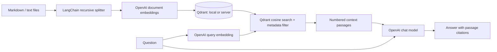

# RAG interview demo: LangChain + OpenAI + Qdrant

A small, inspectable retrieval-augmented generation pipeline over *Alice in Wonderland*
(or your own Markdown/text files). Each stage is explicit so you can demonstrate
what happens between loading a book and generating a source-grounded answer.



| Stage | Implementation | What to demonstrate |
|---|---|---|
| Load | `rag_pipeline/documents.py` | Documents retain relative source paths |
| Split | LangChain `RecursiveCharacterTextSplitter` | Paragraph-aware chunks, overlap, source offsets |
| Embed | OpenAI SDK, `text-embedding-3-small` by default | Documents and questions share a vector space |
| Store | Qdrant client in embedded or server mode | Cosine collections, point IDs, text + metadata payloads |
| Retrieve | Qdrant `query_points` | Top-k, scores, cutoff, and optional source filter |
| Generate | OpenAI SDK, `gpt-4o-mini` by default | Retrieved context, citations, and abstention instruction |
| Evaluate | `rag_pipeline/commands/evaluate.py` | Evidence Hit@k and MRR@k |

## Setup on your Mac

Use your existing Python 3.12 `.venv`. From Terminal:

```bash
cd /Users/redwanwalid/Downloads/generative_ai_exp/rag_tutorial
source .venv/bin/activate
which python
python -m pip install --only-binary=:all: -r requirements.txt
```

The Python path should end in `rag_tutorial/.venv/bin/python`. If another environment
is active, run `deactivate` first. For a fresh checkout, create a virtual environment
with Python 3.10+ using `python3 -m venv .venv` before activation; Python 3.12 is the
intended setup on this Mac.

Versions of the directly used libraries are pinned in `requirements.txt`. Installation
requires prebuilt wheels, so pip will fail clearly instead of invoking Apple's compiler
if no compatible wheel is available. All dependencies were successfully downloaded as
wheels for CPython 3.12/macOS arm64. This is a wheel availability check, not proof of
runtime compatibility on every future macOS release.

By default Qdrant runs embedded in Python: no Docker, separate database server, Qdrant Cloud,
FastEmbed, ONNX Runtime, or Chroma/HNSW compilation is needed. It uses NumPy and other
packages with prebuilt native wheels. Only one process may open this local database
at a time; run these demo commands sequentially.

Your existing `.env` is loaded automatically. Keep its `OPENAI_API_KEY` entry.
Optional settings and defaults are documented in `.env.example`; do not overwrite
your real key with the empty example. Environment variables already exported in the
shell take precedence. API model access and billing depend on your account.

Ingestion sends document chunks to OpenAI. Document queries send the question for embedding
and retrieved passages for generation. Indexing, search-only, comparison, and evaluation
all incur embedding API usage; ordinary answers additionally use the chat API.
`--preview`, `--stats`, and automated tests do not make API calls.
Recognized simple greetings and courtesy messages also make no API calls: both
interfaces use `rag_pipeline/routing.py` before opening Qdrant or an OpenAI client.
This conservative router matches complete messages; greetings with document questions
and all unmatched messages still use RAG. It does not classify arbitrary intent or
provide general knowledge answers. Explicit retrieval-only mode always runs retrieval.

## Streamlit interface and code organization

The same `requirements.txt` installs the CLI, UI, and test dependencies. Start the UI
from the repository root after activating your virtual environment:

```bash
python -m streamlit run app.py --server.address 127.0.0.1
```

Open http://localhost:8501. Use **Documents & index** to preview chunks, inspect the
active collection, or rebuild it; use **Ask documents** for answers and source passages.
The sidebar controls retrieval parameters and whether to skip generation. A generated
answer appears below its question, above the source expanders. Uncheck **Retrieve only**
and submit again if you want an answer for a retrieval-only question.

`app.py` is the launcher. `rag_pipeline/ui.py` contains the sidebar, index, and chat
views. `rag_pipeline/ui_runtime.py` owns the shared database-action lock and timestamped
terminal logging. `rag_pipeline/errors.py` supplies error messages to both the CLI and UI.
Document loading, embedding, ingestion, retrieval, and storage remain in their existing
modules and are reused by both interfaces.

Keep the terminal open to see embedding progress, retrieved source scores, generation
timing, and failures. The UI closes database connections after each operation and
serializes actions across sessions in the same process. Do not run a CLI database
command or another UI process concurrently against the same embedded store. Merely
opening the UI or adjusting controls does not call OpenAI; rebuilding and document questions do.

## Demo sequence

### 1. Show document loading and chunking, without API calls

```bash
python -m rag_pipeline ingest --preview
```

Displays document/chunk counts, three sample chunks, and their source offsets.
Defaults are **1000 characters** with **up to 200 characters** overlap. This is character
splitting, not token splitting; recursive paragraph boundaries can reduce actual overlap.

### 2. Build the vector collection

```bash
python -m rag_pipeline ingest
python -m rag_pipeline query --stats
```

The CLI prints LOAD → SPLIT → EMBED → STORE with counts, embedding dimensions,
and elapsed time. In default local mode Qdrant stores vectors and payloads under `.rag/qdrant/`.
`.rag/active_index.json` records the embedding model, collection, chunk settings,
and dimension. It is metadata only: vectors live in Qdrant and Qdrant performs search.

This is a full rebuild. It reflects removed documents and avoids duplicate points in
the active index. A new collection is published only after all embeddings and uploads
succeed. Failed builds preserve the previous active collection. Previous successful
collections are retained for inspection; repeated builds consume additional disk.

### 3. Isolate retrieval from answer generation

```bash
python -m rag_pipeline query "How does Alice meet the Mad Hatter?" --search-only --top-k 5
```

Shows the nearest passages, cosine scores, source names, and character offsets.
This makes it possible to diagnose retrieval before judging an LLM answer.
Scores are similarities, not probabilities of correctness.

### 4. Show the full RAG pipeline

```bash
python -m rag_pipeline query "How does Alice meet the Mad Hatter?" --show-context
```

Displays the exact retrieved context supplied to the model, followed by an answer
prompted to cite `[1]`, `[2]`, etc. The preceding source list maps each citation to a
passage. Citation instructions reduce unsupported answers; the code does not prove
that every generated claim is supported.

### 5. Demonstrate metadata filtering and thresholds

```bash
python -m rag_pipeline query "What does the White Rabbit carry?" --source alice_in_wonderland.md --search-only
python -m rag_pipeline query "How do I repair a rocket engine?" --min-score 0.8
```

`--source` matches an exact relative path. If nothing passes the cutoff/filter, the
pipeline skips the chat call. The example threshold is illustrative, not calibrated;
a nonempty result set can still be irrelevant. With context present, the model is
instructed to abstain when it cannot answer.

### 6. Evaluate retrieval and compare settings

```bash
python -m rag_pipeline evaluate --top-k 3
python -m rag_pipeline evaluate --top-k 5
python -m rag_pipeline compare "White Rabbit" "rabbit with a pocket watch"
```

The small `evaluation/questions.json` fixture checks whether an expected evidence substring
occurs in a retrieved passage. Hit@k is the fraction of questions with a matching
passage; MRR@k averages the reciprocal rank of the first matching passage (misses score
zero). This is a smoke evaluation, not a robust benchmark or answer-quality evaluation.
Broader hand-labeled evidence spans and questions are needed for meaningful conclusions.
No metric results are claimed before running the real embedding model.

## Change the corpus or chunking

Add `.md`/`.txt` files recursively under `data/books`, then rebuild:

```bash
python -m rag_pipeline ingest --chunk-size 1500 --overlap 250
python -m rag_pipeline ingest --data /path/to/your/documents
```

Default paths resolve relative to the repository, even when commands are run elsewhere.
An explicit `--data` path resolves relative to your current working directory.
Change `OPENAI_EMBEDDING_MODEL` in `.env` and rebuild to switch embedding spaces.
Queries always reuse the active index's model; changing `.env` alone never mixes
query/document embedding models. The chat model can be changed independently.

## Tests and troubleshooting

```bash
python -m unittest discover -s tests -v
```

Tests exercise actual local Qdrant persistence, ranking, filtering, reindexing, failed
build recovery, source offsets, retrieval metrics, and the real OpenAI SDK against a
mock HTTP transport, plus mocked server configuration and search. Streamlit tests also
exercise preview, indexing, generated answers, filtering, and failure recovery.
Tests never call OpenAI.

- Missing modules: verify `which python` and install this requirements file in `.venv`.
- Dependency conflicts: the old environment may contain unrelated LangChain packages;
  this project imports standalone text splitters, Qdrant, and OpenAI directly. For a clean
  demo, create a separate virtual environment and install only these requirements.
- Locked database: stop other commands using the same `.rag/` directory.
- Server connection errors: start `docker compose up -d`, check `QDRANT_URL`, and confirm the server is reachable.
- Switching modes shows no index: ingest into that backend first; manifests and data are separate.
- Missing collection: run `python -m rag_pipeline ingest`.
- OpenAI 401: check the API key; 429: check billing/quota or retry later.
- TLS errors: fix Python's certificate installation; do not disable TLS verification.

References: [Qdrant local mode](https://github.com/qdrant/qdrant-client#local-mode),
[OpenAI embeddings](https://developers.openai.com/api/docs/guides/embeddings),
[OpenAI chat completions](https://developers.openai.com/api/reference/python/resources/chat/subresources/completions/methods/create).

## Choose embedded local or server Qdrant

`RAG_VECTOR_MODE=local` is the default. It preserves the existing embedded database
at `RAG_STORE_DIR/qdrant` and manifest at `RAG_STORE_DIR/active_index.json`.
The installed embedded client performs exhaustive cosine search; it does not build
an HNSW graph. Only one process can open that local database at a time.

For server mode, install/start Docker and run from the repository root:

```bash
docker compose up -d
RAG_VECTOR_MODE=server python -m rag_pipeline ingest --data docs
RAG_VECTOR_MODE=server python -m rag_pipeline query --stats
RAG_VECTOR_MODE=server python -m rag_pipeline query "How are documents split?" --show-context
RAG_VECTOR_MODE=server python -m rag_pipeline evaluate --cases evaluation/docs_questions.json
```

The compose file pins Qdrant 1.14.1 to match the project's 1.14.x client, exposes
HTTP on localhost:6333, and persists server data in a Docker named volume.
`docker compose stop` preserves that data; `docker compose down -v` deletes it.
For another server or Qdrant Cloud, set `QDRANT_URL` and, if required,
`QDRANT_API_KEY`. Use the same configuration for ingestion, query, stats, and evaluation.
The comparison command embeds two strings directly and does not connect to Qdrant.

You can also put these settings in `.env`. Exported shell variables override `.env`:

```dotenv
RAG_VECTOR_MODE=server
QDRANT_URL=http://localhost:6333
QDRANT_API_KEY=
RAG_HNSW_M=16
RAG_HNSW_EF_CONSTRUCT=100
RAG_HNSW_EF=64
RAG_INDEXING_THRESHOLD_KB=20000
RAG_FULL_SCAN_THRESHOLD_KB=10000
```

Server manifests live at `RAG_STORE_DIR/servers/<endpoint-hash>/active_index.json`.
Each URL gets separate active-index metadata; local mode continues using its original
path. Switching modes does not migrate data. Ingest once per backend, or migrate
vectors separately to avoid repeating embedding calls. Server vectors live in the
server's storage, not under `.rag/qdrant`. Credentials are not written to manifests.
Use a separate `RAG_STORE_DIR` when distinct projects share the same server URL.

### What HNSW settings do

- `RAG_HNSW_M`: graph connectivity (positive integer).
- `RAG_HNSW_EF_CONSTRUCT`: effort during graph construction (at least 4).
- `RAG_HNSW_EF`: query-time graph exploration (positive integer).
- `RAG_INDEXING_THRESHOLD_KB`: segment vector size above which indexing is eligible.
- `RAG_FULL_SCAN_THRESHOLD_KB`: below this estimated candidate size, scanning is preferred.

Higher graph/search effort can improve recall at the cost of memory or time.
Build settings apply to new collections: ingest again after changing them.
Query-time EF takes effect on the next search without a rebuild.
The indexing threshold must be at least 1 KB, and the full-scan threshold at
least 10 KB (the pinned server requires this minimum). For a tiny demonstration
corpus, set indexing to `1` and full-scan to `10`, then rebuild. Normal defaults are appropriate for larger collections; 18 points
usually benefit more from exact scanning than a graph.

Server mode permits approximate search (`exact=False`); it does not force every
query through HNSW. The planner may scan small or heavily filtered candidate sets.
Indexing runs in the background: successful upserts and active-manifest publication
mean the data is queryable, not that HNSW construction has finished. Run `query --stats`
to inspect `indexed_vectors_count`, `status`, and `optimizer_status`. A nonzero index
count shows indexed vectors exist, not proof of the search path for every query.
Previous collections are retained in both modes. Concurrent server reads are possible,
but serialize ingestion runs sharing one active manifest (last publication wins).

The bundled evaluation defaults target Alice. Use the included docs fixture after
`--data docs`; choose cases matching the corpus you actually indexed.
Tests mock server requests and use real embedded Qdrant; they do not start Docker.
